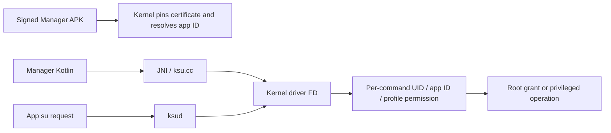

# Authentication and authorization in ikunSU

ikunSU uses Android package/signing identity and Linux process credentials for
native root management, plus a separate bearer token for the local web API.
There is no app account, password login, OAuth flow, JWT, or refresh token.

## Components and trust boundaries

| Component | Identity or credential | Enforcement |
| --- | --- | --- |
| Android Manager | Package `com.hons.ikunSU` and the pinned APK v2 certificate | Kernel package observer and Manager identity tracker |
| Native root requests | Calling process UID, Manager app ID, app profile, SELinux domain and session FD | Kernel IOCTL permission table and allowlist |
| Local web manager | Fresh random bearer token per server session and a verified root process | Root-only ksud service at `127.0.0.1:9178` |
| Installed module WebUI | Enabled installed module and the Manager's JavaScript bridge | Embedded Android WebView and Manager root shell |
| Dialer recovery | System dialer secret-code broadcast | Receiver restores the launcher alias only |
| Build/release automation | APK keystore and GitHub Actions secrets | APK signer, kernel certificate pin and release validation |

## Manager and root request flow

The kernel finds the configured package under `/data/app`, checks its APK v2
certificate size and SHA-256 against values compiled into the kernel module, and
maps that verified package to its app ID from Android's package records. APK
installation signature verification is handled by Android; the kernel's
`apk_sign.c` implements certificate pin matching, not a separate full APK
cryptographic signature verifier.

The default pin is public information: certificate size `0x36e` (878 bytes),
SHA-256 `f00129f638639a1d41cb71d4f3e63c25b3a87127ac8eb038dd74ca0774d05c5f`.
Changing the signing key requires rebuilding the matching kernel module.

Manager Kotlin calls enter the JNI bridge. JNI and ksud find or install the
`[ksu_driver]` file descriptor and send IOCTLs. Possessing a driver FD does not
authorize every command: the kernel checks the caller for each IOCTL.



The permission table allows public status queries, restricts some operations to
UID 0, permits others to Manager or root, and reserves app profile changes for
the Manager app ID. Root grants require the Manager identity or the allowlist;
UID 0 grants are also checked against the KernelSU SELinux domain. The allowlist
and profiles persist locally at `/data/adb/ksu/.allowlist`.

Relevant code:

- [`kernel/manager/apk_sign.c`](../kernel/manager/apk_sign.c): bounded APK v2
  parsing and pinned certificate hash/size checks.
- [`kernel/manager/throne_tracker.c`](../kernel/manager/throne_tracker.c) and
  [`manager_identity.h`](../kernel/manager/manager_identity.h): package discovery,
  app ID tracking and invalidation; Manager comparisons use UID modulo 100000.
- [`kernel/supercall/perm.c`](../kernel/supercall/perm.c),
  [`dispatch.c`](../kernel/supercall/dispatch.c) and
  [`supercall.c`](../kernel/supercall/supercall.c): IOCTL checks and session FDs.
- [`kernel/policy/allowlist.c`](../kernel/policy/allowlist.c): per-UID root grants.
- [`manager JNI`](../manager/app/src/main/cpp/ksu.cc) and
  [`ksucalls.rs`](../userspace/ksud/src/ksucalls.rs): userspace driver wrappers.

## Local web API request flow

The Manager runs `ksud webui start` through its root shell and obtains the
authenticated URL from `ksud webui url`. The CLI rejects non-root effective UIDs.
The server checks UAPI compatibility and binds only to the loopback address.

After successfully binding the loopback port, ksud reads 32 fresh bytes from
`/dev/urandom`, encodes them as 64 lowercase hex characters, and atomically
replaces `/data/adb/ksu/webui.token` with a root-owned mode 0600 file. It then
publishes its PID in a separate root-owned mode 0600 `webui.pid` file. Each
successful server start rotates the token; a failed bind, health probe or
autostart preference change never creates credentials for a future server.

Before reading a token or sending it to the listener, CLI probes, shutdown and
URL retrieval validate the PID file's owner, permissions and regular-file type.
They reject symlinks, check that `/proc/<pid>/status` reports effective UID 0,
and require the process command line to contain exactly an executable followed
by `webui serve`. This accepts both installed ksud and the Manager's bundled
daemon without trusting an unrelated process that only occupies port 9178.
Normal exit removes only the server's own PID record before releasing its
listening socket. A crashed service's stale PID is rejected when the process no
longer exists, has a non-root effective UID, or has another command line.

A service can exit between the process check and connection or browser launch.
Any token exposed to a replacement listener in that interval belongs to the
ended session: the next legitimate server first binds the port and then rotates
its token before accepting requests. It never reactivates the leaked token.

The URL is `http://127.0.0.1:9178/#<token>`. The fragment is read by browser JS,
saved in tab `sessionStorage`, and removed from the address bar using
`history.replaceState`. URL fragments are not sent in HTTP request targets.
Every API fetch sends `Authorization: Bearer <token>`.

```mermaid
sequenceDiagram
    participant M as Signed Manager
    participant D as Root ksud
    participant B as Browser tab
    participant K as Kernel
    M->>D: webui start / webui url through root shell
    D-->>M: Loopback URL with token fragment
    M->>B: Open authenticated URL
    B->>B: Move token to sessionStorage; clear URL fragment
    B->>D: API request with Bearer token
    D->>D: Check Host, Origin, exact token and HTTP method
    D->>K: Permitted IOCTL or validated module operation
    K-->>D: Enforce caller credentials; return result
    D-->>B: JSON with no-store response headers
```

The server requires `Host: 127.0.0.1:9178`; if Origin is supplied, it must equal
`http://127.0.0.1:9178`. The HTML entry page can load without a token, but API
requests cannot. Changes require POST. Package/UID pairs, module IDs, JSON size,
and module upload size are validated before mutation. Responses disable caching,
framing and referrer transmission; CORS is not enabled.

App profile updates need the authenticated Manager real UID, while the web server
has real UID 0. A short-lived root-only grant subprocess obtains the Manager app
ID from the kernel, matches it against the installed package record, validates
the target package/UID, and changes only its own real UID to that app ID while
keeping effective/saved UID 0. It then calls the existing Manager-only profile
IOCTLs and exits. The web server credentials and kernel permission table remain
unchanged.

Relevant code and API documentation:

- [`webui.rs`](../userspace/ksud/src/webui.rs): token file, root gate, service,
  request dispatch and grant helper.
- [`webui_auth.rs`](../userspace/ksud/src/webui_auth.rs): exact Host/Origin/token
  authorization and tests.
- [`webui.html`](../userspace/ksud/src/webui.html): token handoff and API headers.
- [`IkunSettingsScreen.kt`](../manager/app/src/main/java/me/weishu/kernelsu/ui/screen/ikun/IkunSettingsScreen.kt): Manager root shell entry.
- [`IKUNSU_WEB_API.md`](IKUNSU_WEB_API.md): commands, routes and request limits.

The bearer token grants the running local web API's root capabilities to its
holder. It is stored on disk without application-level encryption and compared
as an exact string; its validity ends with that server session. HTTP is used
only on loopback; the service is not designed for LAN exposure. Restarting the
service invalidates previous URLs and browser sessionStorage tokens. Open a
fresh authenticated URL from the Manager after restarting. Browser
sessionStorage remains accessible to scripts running in that origin, but a
token retained there cannot authenticate a later session.

When upgrading from the earlier daemon that had no `webui.pid` record, stop its
web server once using that earlier Manager/daemon, or reboot with autostart
disabled. The updated CLI intentionally refuses to send a bearer token to an
unverified legacy listener.

## Installed application labels

Installed application labels in the local web manager come from a separate,
read-only PackageManager helper in the signed Manager APK. Before loading its
DEX, ksud checks the kernel's authenticated Manager app ID against the primary
package record and compares the actual APK v2 certificate with its compiled
size/hash. CI supplies that same certificate identity to both ksud and the
kernel, including temporary CI keys. The helper's labels and system-app flags
are presentation metadata; root changes still validate package/UID records and
use kernel authorization independently.

## Installed module WebUI bridge

This is separate from the loopback HTTP web manager. `prepareWebView` in
[`WebViewHelper.kt`](../manager/app/src/main/java/me/weishu/kernelsu/ui/webui/WebViewHelper.kt)
checks that the requested module exists, is enabled, has a WebUI, and is not
pending update or removal. It serves the module's local `webroot` through
`WebViewAssetLoader` under `mui.kernelsu.org` and exposes a JavaScript interface
named `ksu`. [`WebViewInterface.kt`](../manager/app/src/main/java/me/weishu/kernelsu/ui/webui/WebViewInterface.kt)
implements `exec` and `spawn` through the Manager's root shell;
[`js/index.js`](../js/index.js) wraps these bridge calls. There is no separate
HTTP bearer-token login for this embedded module bridge. Installed module
JavaScript runs as a privileged extension, so its root-shell access depends on
trusting the installed module rather than the loopback server's token.

Dialer code `*#*#917891786688#*#*` only restores the disabled launcher alias.
The receiver accepts the exact code URI for the protected modern or legacy
Android secret-code action. It does not authenticate web requests, change root
profiles, or grant root access. See the
[`dialer recovery receiver`](../manager/app/src/main/java/me/weishu/kernelsu/ui/stealth/DialerRecoveryReceiver.kt).

## Build credentials and GitHub tokens

The APK private signing key and passwords stay under the ignored
`private-signing/` directory locally. CI receives them through `KEYSTORE`,
`KEYSTORE_PASSWORD`, `KEY_ALIAS` and `KEY_PASSWORD` repository Actions secrets.
The build derives the certificate pin from the actual key, passes that public
pin to the LKM build, and signs the Manager with the same key. Release validation
checks the APK certificate against this identity and refuses temporary CI keys.
Keystore material and passwords are excluded from source archives and Git.

GitHub's `GITHUB_TOKEN` is a separate, job-provided credential. Build jobs use
read-only repository permissions; the release publishing job receives
`contents: write`. It has no role in phone root authorization or web API tokens.
The local GitHub CLI uses the user's authenticated GitHub session and OS keyring;
its token is not placed in the repository, APK or build artifacts.

See [`build-manager.yml`](../.github/workflows/build-manager.yml),
[`release.yml`](../.github/workflows/release.yml),
[`collect-release.py`](../scripts/collect-release.py) and
[`kernel/Kbuild`](../kernel/Kbuild).
